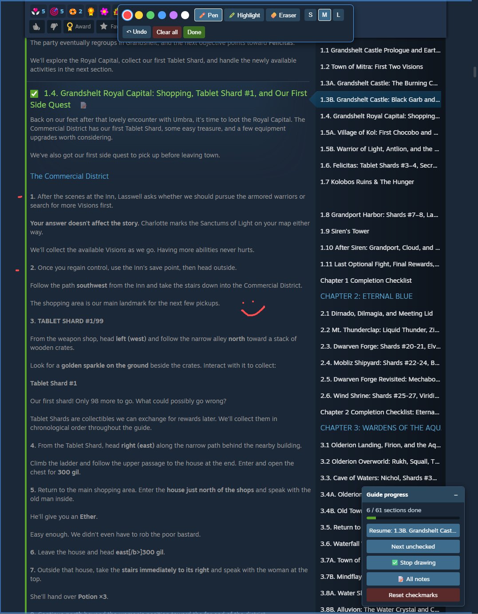

  

<h1 align="center">Steam Guide Enhancer</h1>

A small Brave / Chrome extension that makes long Steam Community guides easier to follow. It lets you tick off sections, take notes, draw on the page, and jump back to where you stopped. Everything is saved in your browser, so it's still there after you restart your PC.

  

## Features

- **Checkboxes** on every section title and Guide Index entry, plus a progress bar ("3 / 12 sections done")
- **Auto-fill**: ticking a section also ticks every section before it. Unticking only affects that one section
- **Resume where I left off** remembers the section you were reading and how far into it you were
- **Next unchecked** jumps to the first section you haven't ticked yet
- **Notes**: click 📝 next to any section title to write a note. **📝 All notes** lists every note in the guide
- **Draw anywhere** on the page with a pen, a highlighter and an eraser, in 6 colours and 3 sizes, with undo (Ctrl+Z). Drawings stay pinned to their part of the guide while you scroll
- Progress is saved **per guide**, so it works on any Steam guide

## Install (Brave, Chrome, Edge)

1. Download this repo: **Code → Download ZIP**, then unzip it somewhere permanent. The browser loads the extension from that folder, so don't delete it.
2. Open `brave://extensions` (or `chrome://extensions` / `edge://extensions`).
3. Turn on **Developer mode** (top-right).
4. Click **Load unpacked** and select the unzipped folder.
5. Open any Steam guide, for example `https://steamcommunity.com/sharedfiles/filedetails/?id=...`

To update, replace the files in the folder and click the reload ↻ icon on the extension card.

## Usage

| What | How |
|---|---|
| Mark a section done | Tick the checkbox next to its title or in the Guide Index |
| Go back to your spot | **Resume: <section>** in the bottom-right panel |
| Add a note | 📝 next to a section title |
| Draw / highlight | **✏️ Draw on page**, then pick a tool from the top toolbar. Press **Esc** or click **Done** to stop |
| Hide the panel | **–** in the panel header |

Checkboxes and 📝 buttons still work while draw mode is on. Other clicks become pen strokes, so leave draw mode to click links.

## Privacy

Everything stays in your browser (`chrome.storage.local`). The extension makes no network requests and only runs on `steamcommunity.com/sharedfiles/filedetails/*` pages.

## Disclaimer

Not affiliated with or endorsed by Valve Corporation. Steam is a trademark of Valve Corporation.

## Author

Made by **Diogo Marques**: [github.com/DiogoAlmMarques](https://github.com/DiogoAlmMarques)

## License

MIT
